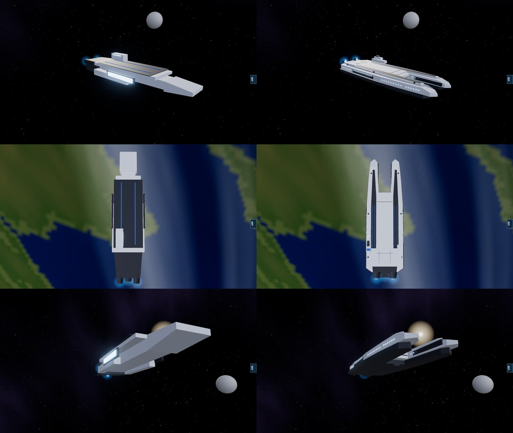

# Alliance carrier, 11 November 2026

Owner's report: "improve or rework low grade blocky designs for better likeness as per reference pack".

The Alliance dreadnought, cruiser and frigate were rebuilt earlier from the private reference frames (`ALLIANCE_HULLS_QA_2026-11-10.md`; the tests are `tests/alliance-hulls.test.ts`). The carrier was not: it was still a dozen boxes, and the most conspicuous block hull in an Alliance fleet.

## What it looked like

- A box hull under a box flight deck, a box island, a wedge bow.
- Each hangar was a slab in the lit-window material, 30 m tall and 240 m long: the brightest thing in the fleet.
- The model was 9.82 units long for a stated length of 9.

## What it is now

Original procedural geometry in the armour of the line hulls (layered pale deck plates over a dark ventral tier and keel, rows of small lit ports, blue markings), with its own outline:

- the deck runs forward into two launch prongs either side of an open channel, with chiselled tips;
- a dark flight strip with two blue guide lines runs along each prong;
- a long hangar mouth opens in each flank, dark, with a thin strip of light inside it;
- the bridge is a stepped island on the starboard deck edge with a mast; a low deck house balances it to port;
- three drives. The hull is 9 units from prong tips to exhaust.

Left: before. Right: after. Same camera positions (quarter, from above, from below the bow). Software renderer.

The reference frames show Alliance line hulls, not a carrier, so there is no frame to compare this hull against. What it takes from them is the armour language already used on the dreadnought and cruiser. The outline is this project's own.

## Measured

| | Before | After |
|---|---|---|
| Triangles | 432 | 1,976 |
| Model length for a stated 9 units | 9.82 | 9.00 |
| Tallest lit element | 30 m (hangar slab) | 3.8 m (a port) |
| Engine glows | 3 | 3 |

The engine glows move with the drives: they were 0.26 units behind the stated stern and are now at it. Nothing in the simulation reads the model; the carrier's size, hangar, weapons and movement are unchanged.

`tests/alliance-hulls.test.ts` gains one case for the carrier: length, engine nodes, five merged meshes, triangle budget, full beam amidships, the open launch channel, the island's position, and that no lit element is taller than 4.5 m.

## Not verified

- How it reads in motion and at fleet scale on real hardware.
- Fighters do not launch from the hangar mouths or the channel: launches are placed by the simulation around the carrier as before.

## Still open

Other factions' capitals are still built from a few tapered boxes each (turian, asari, salarian, quarian, geth, Cerberus). The reference pack has no frames of them.
