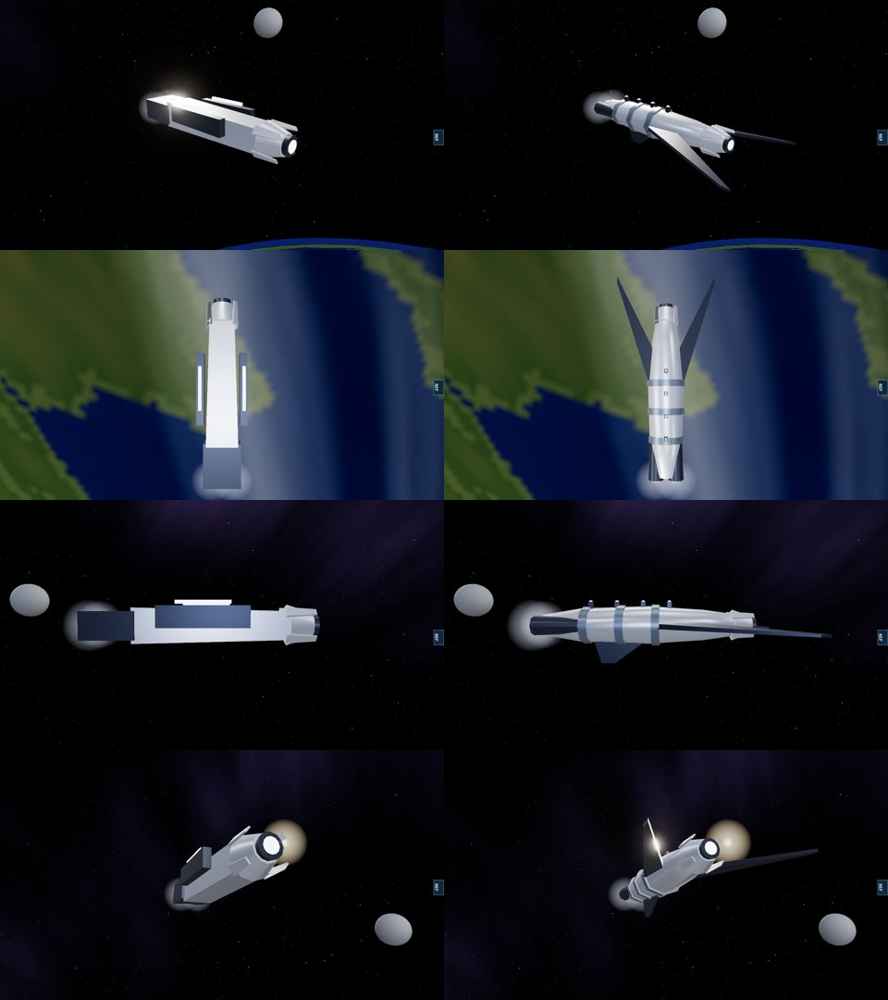
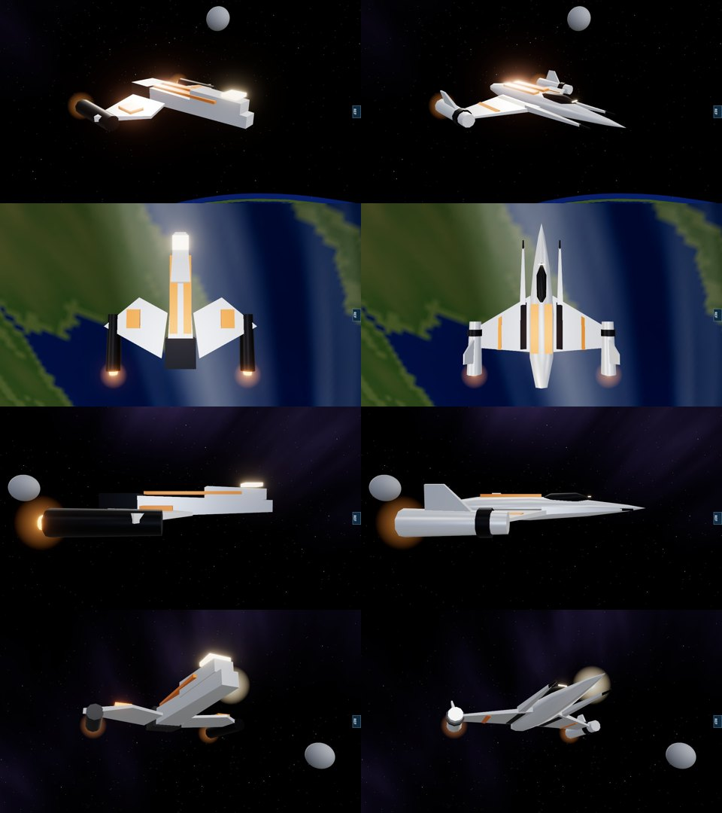

# Geth and Cerberus frigates, 12 November 2026

Owner's report: "improve or rework low grade blocky designs for better likeness".

After the turian frigate (`TURIAN_FRIGATE_2026-11-11.md`) these were the two frigates still made of boxes. Both are rebuilt from the fighter kit (`src/rendering/ships/fighterKit.ts`) in the design language their own files describe. All geometry is generated in code.

## Geth frigate

It was a box with the geth family's head on it and a dark box either side.

It is now a rounded, segmented body carrying that same hooded head and single optic between two forward-swept mandibles that reach the muzzle, with three collars round the body, a short lattice of lit struts along its back, a keel fin and two drives.

## Cerberus frigate

It was a tapered box under a smaller box with a lit block for a bridge, two flat plates for wings and two cylinders.

It is now a flattened six-sided hull drawn to a point at the muzzle, with a dark raised bridge, twin forward booms tipped with guns, swept wings with black root panels and orange stripes, and the drives in nacelles on the wing tips under canted fins.

In both pictures: left before, right after, same camera positions (quarter, from above, side, from below the bow). Software renderer.

## Measured

| | Geth before | Geth after | Cerberus before | Cerberus after |
|---|---|---|---|---|
| Triangles | 328 | 644 | 280 | 552 |
| Nose of the model against its muzzle | 0.19 units short | at it | 0.13 units short | at it |
| Length, muzzle, engine nodes | | the same | | the same |

Nothing in the simulation reads the models. `tests/frigate-hulls.test.ts` (4 cases) holds length, muzzle, engine nodes, outward-facing surfaces, the triangle budget and each hull's defining shapes.

The "before" figures were measured on an older checkout of this repository (`80ea61a`); neither frigate's builder had changed since.

## Not verified

- How either reads in motion and in numbers on real hardware.
- Likeness to the games' ships: the private reference pack has no geth or Cerberus frames, and neither was compared against one.

## Still block models

Geth cruiser and dreadnought (a deliberate design of head, ring and segmented spine, but built from boxes); quarian heavy cruiser.
