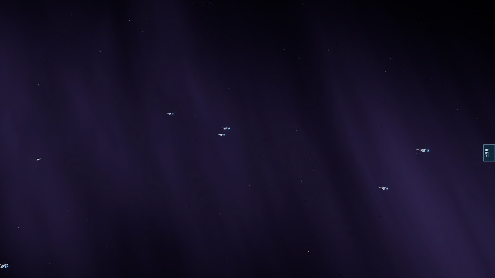
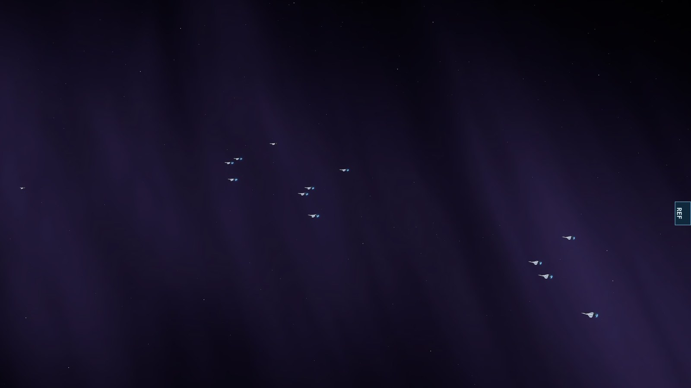

# Combat AI and fleet movement overhaul, first pass — 12 November 2026

Owner's directive: "The simulator currently spends too much time showing ships chasing one another rather than fighting. Fix the underlying combat AI, targeting, movement and fleet behaviour ... Remove fleet command controls unless they actually produce reliable, observable behaviour ... Do not simply adjust cosmetic settings."

This note covers the first pass: target selection, how hulls present their guns, closing speed, and the fleet command audit. What it does not cover is listed at the end.

## How it was measured

`scripts/combat-activity.ts` (logic in `src/simulation/combatActivity.ts`) puts every armed hull, once a second, in one class:

| Class | Meaning |
|---|---|
| firing | fired within one cycle of its quickest anti-ship weapon (at least 4 s), or has a beam on |
| silent | has a target inside its main-battery range and is not firing |
| closing | its target is out of range and the gap shrank over the last second |
| chasing | its target is out of range and the gap did not shrink |
| idle | has no target |

Hull-seconds are counted from the battle's first shot to its end. Run: `npx tsx scripts/combat-activity.ts <scenario|custom> [rules] [seeds] [seconds] [scale]`.

## What was wrong

Measured on the build before this change:

1. **A whole fleet chose one target.** At 15 s into the Battle of Earth all 88 Alliance hulls were aiming at one Reaper capital that none of them could reach. At 30 s a Reaper destroyer inside the range of 30 hulls had 3 aiming at it. Hulls flew at the favourite past enemies they could have been shooting, pointing their spinal guns at it.
2. **Most guns never bore.** Every hull stood bow-on to its target. Cruisers and carriers carry most of their fire in side batteries: an Alliance cruiser has 159 damage a second ahead and 240 on either beam, and fought with the 159. A carrier has only side batteries and never fired. In one traced battle a dreadnought's eight broadside batteries did not fire once in 84 s.
3. **A hull whose target died flew backwards.** It kept the dead target until its next decision, up to three seconds, and made for its place in the formation meanwhile.
4. **Hulls crossed to an out-ranging enemy at combat speed.** Reaper capitals out-range everything (21.6 against 7.2 to 17.6) and stop at their own range. A cruiser needed about 40 s to cross.
5. **Hulls on the wings of a large fleet had no target** until the fleet's advance, at the pace of its slowest capital, brought one into their own sensor range.

## What changed

All in `src/simulation/ai.ts` unless noted.

- **Fight what is in reach.** A hull with an enemy hull inside its main battery's range fights one of those. It does not keep or choose a target it cannot hit while there is one it can. A player's or a fleet's commanded target is the exception. Fighters do not count as "in reach" for warships.
- **Spread the fire.** A target's attraction falls with the value of the hulls already aiming at it (`OVERKILL_SHARE`). The battle keeps a table of that load, rebuilt every half second (`battle.ts`).
- **Decide again at once** when a target dies or leaves (`battle.ts`).
- **Nearest enemy as a fallback** for a hull in an attacking fleet with nothing in its own sensor range.
- **Beam-on batteries** (`batteryAspect`, `beamFacing`). Each hull's guns are summed once: what bears ahead, and what bears on each beam. A hull whose side batteries out-shoot its bow guns by 15 % engages at their range and, once the target is inside it, turns that side toward it (80 degrees off the bow). Cruisers and carriers do; dreadnoughts, frigates and Reapers stay bow-on. Only the facing changes, so it does not become an orbit.
- **Closing sprint** (`closingSprint`; `motion.ts`). A hull whose target is beyond its guns drives at up to twice its combat speed and thrust, easing to combat speed as the target comes into range and whenever it is steering clear of a neighbour. Reapers do not sprint.
- **Wider swings** for frigates (60 to 150 degrees round their target, was 45 to 105) and Reaper destroyers (30 to 100, was 20 to 60) (`manoeuvre.ts`). Spreading the fire took away the flanking that the dog-pile had produced by accident: the share of Alliance attackers abaft their target's beam fell from 0.26 to 0.10 over eight seeds. With the wider swings it is 0.16.

## Results

Share of hull-time spent firing, all hulls except fighters. "Before" is commit `83bad0b`.

| Battle | Rules | Before | After | Winner (both) |
|---|---|---:|---:|---|
| Default Custom Battle (55 v 12), 3 seeds | canon_me3 | 78 % | 80 % | Reapers |
| Battle of Earth, 3 seeds | canon_me3 | 78 % | 80 % | Reapers |
| Final Battle of Earth, 2 seeds | canon_me3 | 77 % | 77 % | Reapers |
| Defence of Palaven, 2 seeds | canon_me3 | 84 % | 85 % | Reapers |
| Default Custom Battle, 3 seeds | prime_apex | 63 % | 69 % | Alliance |
| Custom Battle at four times the size, 2 seeds | prime_apex | 48 % | 58 % | Alliance |
| Battle of Earth, 3 seeds | prime_apex | 52 % | 57 % | Alliance |
| Final Battle of Earth, 2 seeds | prime_apex | 43 % | 60 % | Alliance |

The share of time moved less than the amount of fire. Shots (and beam-seconds) per hull-minute, canon_me3:

| Class | Custom before | after | Battle of Earth before | after | Final Battle before | after |
|---|---:|---:|---:|---:|---:|---:|
| Alliance dreadnought | 27 | 58 | 36 | 60 | 37 | 55 |
| Alliance cruiser | 45 | 65 | 46 | 64 | 52 | 67 |
| Alliance carrier | 1 | 52 | 15 | 61 | 9 | 35 |
| Alliance frigate | 42 | 50 | 41 | 54 | 38 | 47 |

Other measurements:

- **Target spread**, Battle of Earth at 15 s: the ten Reapers have 30, 18, 16, 6, 5, 5, 5, 1, 1 and 1 of the 88 hulls on them (before: 88 on one).
- **Target changes**: 2.3 to 2.6 a hull-minute under canon rules (2.7 before on the canon Custom Battle, seed 1).
- **Hull contacts at every tick** (`scripts/contact-check.ts`): none in 24 control battles (12 seeds each rule set), nor in the Battle of Earth (3 seeds) or the Final Battle of Earth (4 runs). The first version of the sprint caused contacts between sprinting frigates and between sprinting Reaper destroyers; easing the sprint near neighbours and removing it from Reapers ended them.
- **Battles are shorter**, because more guns fire: for example the canon Custom Battle 222 s to 184 s, the prime_apex Final Battle of Earth 135 s to 68 s. Winners are unchanged in every setup measured.
- **Simulation cost** (`scripts/scale-benchmark.ts`, 30 s, this machine): mean tick 0.92 to 1.00 ms at 92 ships, 4.1 to 5.7 ms at 552, 17.4 to 21.8 ms at 2,208. About a quarter dearer at scale, with two thirds more events (shots) to process. The worst single tick at 2,208 ships was 40 ms before and 65 and 122 ms after in two runs; no one cause was found in the slowest ticks.

## Fleet commands

Each order was given to the Alliance fleet 30 s into the canon Custom Battle (3 seeds) and the next two minutes measured.

| Order | Hulls firing | In range | Moved | Verdict |
|---|---:|---:|---:|---|
| Attack | 95 % | 91 % | 17.6 km | kept |
| Advance | 95 % | 91 % | 17.6 km | removed: identical to Attack in every figure |
| Flank | 96 % | 93 % | 14.9 km | removed: the fleet's bearing round the enemy no longer differs from Attack (6 to 48 degrees against 28 to 64 at 90 s, six battles each), because hulls fight what is in reach |
| Break through | 78 % | 64 % | 13.3 km | removed: takes hulls out of the fight |
| Regroup | 91 % | 86 % | 18.4 km | removed: re-forms a formation that hulls no longer hold in combat |
| Screen | 64 % | 44 % | 5.9 km | removed: takes escorts out of range, and protects nothing (there is no line-of-fire masking) |
| Hold formation | 65 % | 47 % | 12.8 km | kept, as "Hold position" |
| Defend position | 65 % | 47 % | 12.8 km | removed: identical to Hold |
| Withdraw | 49 % | 34 % | 39.5 km | kept: falls back while fighting |
| Retreat | 6 % | n/a | leaves | kept: 27 hulls leave the battle |

The battle HUD now offers Attack, Hold position, Withdraw and Retreat. Flank, Break through, Screen and Regroup are removed from the simulation as well as the HUD, with their tests (`fleet-intent`, `regroup`, `screen`). `advance` and `defend_position` remain valid order names for existing scenario data and behave as before. Under every kept order each hull still shoots at whatever comes within its guns.

## Tests

- New: `tests/combat-engagement.test.ts` (11 cases): fighting what is in reach, the commanded exception, target spread, no stale targets, battery aspect by class, cruiser and carrier turning beam-on and firing their broadsides, the sprint's shape and limits, and battle-level activity under both rule sets.
- Removed with their features: `tests/fleet-intent.test.ts`, `tests/regroup.test.ts`, `tests/screen.test.ts`.
- Restated with measured values and reasons in place: `tests/altitude-lanes.test.ts` (now run under canon rules, where the battle is still being fought at 100 s; lane limit judged against a fleet's longest range), `tests/visual-weight.test.ts` (main guns 26 % to 75 % of tracer area, was 12 % to 53 %: more main rounds are in the air), `tests/reaper-advance.test.ts` (a Reaper capital fires in 82 % of ten-second looks, was 91 %: frigates now get astern of it and it turns slowly).
- Unit suite: 83 files, 496 tests pass. Production build passes.

## Second pass, same day: fighter wings and friendly formations

### Fighters

An Alliance fighter facing Reapers that have no Oculus out had two torpedoes a sortie and nothing else to fire: its gun engaged only small craft and missiles. Each fighter also chose its own target.

- **Strafing** (`battle.ts`): a fighter with no small craft or missile to shoot at fires its gun at the hull it is attacking.
- **Wings** (`wingLeader` in `ai.ts`): fighters are numbered as they launch, so each block of four consecutive numbers is a wing that left its carrier together. Every fighter but the wing's leader takes the leader's target. The leader is the lowest-numbered craft of the wing still in the fight. No state is kept.

| | Before | After |
|---|---:|---:|
| Fighters firing, canon Custom Battle (3 seeds) | 18 % | 38 % |
| Fighters firing, canon Battle of Earth (3 seeds) | 20 % | 41 % |
| Fighters firing, prime_apex Battle of Earth (3 seeds) | 17 % | 33 % |
| Attack runs per fighter-minute, canon Battle of Earth | 3.3 | 4.0 |
| Wing-mates on their leader's target (prime_apex Battle of Earth, 30 to 120 s) | not a rule | 91 % of looks |
| Eight fighters against one destroyer, 90 s | 16 torpedoes | 16 torpedoes and 4,694 gun rounds |

Winners are unchanged. The canon Custom Battle is shorter again (184 s to 164 s): the strafing is damage that was not there before.

**A trade-off the owner should know about.** Yesterday's report was that fighter gunfire "draws too much visual attention". Its tracers, flashes and hits were made small (`VISUAL_WEIGHT_2026-11-11.md`), and that is unchanged. But fighters now fire their guns far more often, at hulls. If the result is noisy again, the remedy is in the drawing rules, not here.

### Friendly formations

Measured, not changed. A fleet of 36 hulls attacks an enemy lying directly behind an allied fleet of 46 hulls that holds its position (`tests/friendly-crossing.test.ts`; weapons do no damage). Compared with the same battle without the allied fleet:

| | Seed 1 | Seed 2 | Seed 3 | Seed 4 |
|---|---:|---:|---:|---:|
| Nine tenths of the attackers in range, nothing in the way | 80 s | 76 s | 72 s | 78 s |
| Through the allied fleet | 79 s | 76 s | 73 s | 82 s |
| Attackers that came out the far side | 36 of 36 | 36 of 36 | 36 of 36 | 36 of 36 |
| Hull contacts at any tick | 0 | 0 | 0 | 0 |
| Allied hull pushed furthest | 0.16 km | 0.06 km | 0.18 km | 0.12 km |

So friendly fleets do not behave as walls and there is no deadlock to fix: the clearance rules already let hulls pass between, above and below each other. One closer-packed variant of the same experiment (fleets 6 km apart instead of 22) showed 11 contact pair-ticks in one of two seeds, at most 5 % deep, as attackers slowed to engage in the middle of the allied line.

## Third pass, same day: fighters stay over their target

**What was wrong.** A fighter carries two torpedoes and a gun. It turned for its carrier in the tick its second torpedo left, although the gun (which since the second pass it fires at hulls) needs no reloading. Counting every fighter each second (`in gun range`: within the gun's reach of its target's hull):

| Where a fighter's time went, before | Battle of Earth, canon | Battle of Earth, prime_apex | Custom, prime_apex | Final Battle, canon |
|---|---:|---:|---:|---:|
| In gun range of its target | 30 % | 14 % | 13 % | 25 % |
| On the way out | 33 % | 46 % | 46 % | 36 % |
| Flying home and in the hangar | 31 % | 31 % | 33 % | 30 % |

A sortie was about 30 s armed followed by 20 to 25 s away, with the carrier 55 to 77 km behind the fight.

**What changed.** A fighter that has fired its last torpedo stays over its target for 15 s (`STATION_SECONDS`), strafing, and then turns for its carrier as before. The carrier, the 12 s in the hangar and the torpedo load are unchanged.

| Fighters, before → now (two seeds) | Firing | Attack runs a minute | Rounds a minute | In gun range |
|---|---:|---:|---:|---:|
| Battle of Earth, canon | 43 → 53 % | 4.3 → 6.2 | 107 → 161 | 30 → 46 % |
| Battle of Earth, prime_apex | 33 → 44 % | 2.3 → 3.9 | 50 → 116 | 14 → 27 % |
| Custom Battle, canon | 40 → 46 % | 3.6 → 4.7 | 85 → 122 | 25 → 36 % |
| Custom Battle, prime_apex | 32 → 47 % | 2.4 → 4.5 | 54 → 126 | 13 → 30 % |
| Final Battle of Earth, canon | 41 → 57 % | 3.5 → 5.4 | 96 → 149 | 25 → 41 % |

**What it costs.** Fighters over a Reaper fleet die at a steady rate, so more time there means more losses. Over four seeds of each battle the winner is the same in all twenty. Hulls lost over the four seeds, in the table's order: Alliance 184 → 184, 35 → 37, 224 → 224, 63 → 70, 500 → 500; Reaper 0 → 0, 52 → 52, 5 → 4, 48 → 48, 25 → 22. Fighter damage dealt rises 17 to 86 %. Fighter losses: the three canon battles lose every fighter before and after (their side loses every hull); Battle of Earth under prime_apex 16 → 17 %; Custom Battle under prime_apex **39 → 91 %**, in a battle the Alliance still wins. That last figure is the price of the change and the owner may prefer a shorter stay: at 10 s it measured 76 % lost with nearly the same damage, at 30 s every fighter lost.

**And more cannon fire on screen,** which is what the owner's report of 11 November was about: fighter cannon went from 2 to 18 % of the area tracers cover to 13 to 22 %. The drawing now shows one cannon round in four, as a belt of tracer (`VISUAL_WEIGHT_2026-11-11.md`), which brings that to 3 to 6 %. The simulation is not affected.

**Tried and not kept.** A sprint for fighters in transit (the hulls' closing sprint, to and from the carrier). It cut the outbound share only from 47 to 35 % in one battle, and fighters reached the Reapers and died sooner: losses in the Battle of Earth under prime_apex rose from 17 to 46 % with less damage dealt. Removed.

No hull contacts at any tick in six seeds of the canon Battle of Earth. `tests/fighter-wings.test.ts` has the new case (24 fighters each turn for home exactly 15 s after their last torpedo, having fired 2,049 gun rounds between them meanwhile, and still reload three times each in 150 s).

## Fourth pass, same day: a depleted fleet fights where it stands

**What was wrong.** Found by following one Custom Battle that ran to its 300 s limit. For its last two minutes two Alliance dreadnoughts, at 90 % hull and in range of a Reaper destroyer, flew steadily sideways with it while the other ten Reapers followed at a closing speed of a tenth of a unit a second.

A fleet judged its distance to the enemy, and steered, from its anchor: the point its formation was laid out round. Those two dreadnoughts were the far end of a formation of 56 hulls, so their places were 40 km to one side of the anchor. They were in range; the anchor was not, so the fleet stayed in "approach" and marched its line toward the destroyer. The destroyer's own station is a bearing round the hull it is attacking, so it moved off as that hull moved, and the two went round each other for the rest of the battle.

Reproduced without the rest of the battle (`tests/depleted-fleet.test.ts`): a full Custom Battle formation with only the two dreadnoughts on one end left, against one destroyer, nothing destructible, 300 s.

| | Before | Now |
|---|---:|---:|
| Distance each dreadnought flies after first getting in range | 175 km | 18 km |
| Share of that time under way | 100 % | 12 % |
| Fleet's state at 100 s | approaching | holding |
| Shots each | 384, 379 | 380, 381 |

**What changed.** A fleet measures and steers from where its line stands: the anchor, moved by as much as the middle of the places still filled has moved from the middle of all the places the line started with. While the line is whole that is exactly the anchor, so a fleet at full strength behaves as it did. The line is the capitals, or the cruisers once there are no capitals, or every hull once there are neither, as before.

Over eight seeds of five battles (forty battles), the winner is the same in every one:

| | Mean length | Longest | Hulls firing |
|---|---:|---:|---:|
| Custom Battle, canon | 179 → 175 s | 219 → 202 s | 83.6 → 83.0 % |
| Custom Battle, prime_apex | 95 → 95 s | 127 → 125 s | 71.3 → 71.0 % |
| Battle of Earth, canon | 149 → 139 s | 224 → 167 s | 79.8 → 80.8 % |
| Battle of Earth, prime_apex | 92 → 91 s | 102 → 102 s | 57.7 → 57.9 % |
| Final Battle of Earth, canon | 225 → 211 s | 269 → 232 s | 79.9 → 81.1 % |

The long tails shorten where a losing side is ground down to a few hulls (the three canon battles); the averages hardly move, because most battles never reached this state. Battles are chaotic: any change alters which seed has the long ending, so the controlled case above is the evidence and this table is the check that nothing else moved. No hull contacts at any tick in six seeds of the canon Battle of Earth.

One pinned figure was restated: Reaper capitals' firing share in the long Custom Battle at seed 1 is 84 % (88 % before; floor 0.85, now 0.78). Over four seeds it is 83 % before and after. A capital with a target in range is silent about a tenth of the time, turning its guns onto it; not addressed.

## Fifth pass, same day: a sprinting hull keeps its thrust to give way

**What was wrong.** Counted at every tick, hulls still touched in the Battle of Earth under prime_apex: over thirty seeds, five had a contact, 85 pair-ticks in all, the deepest 57 % of the two hulls' radii. All were at about 60 to 80 s, when 49 frigates sprint toward the second Reaper wave.

The closing sprint (first pass) doubles a hull's top speed and its thrust, and is eased while the hull steers clear of a neighbour. Easing it took the thrust away along with the speed limit. A frigate doing twice its combat speed that began to give way had, from that moment, half the thrust to shed twice the speed.

**What changed.** A hull above its combat speed keeps the thrust that took it there, in proportion to the speed it still carries, for giving way and for slowing down. Steering for its goal keeps the eased figure, so the extra goes to getting out of the way and not to pressing on. (A first version gave it to both; that cleared the frigates but let a Reaper destroyer into a cruiser in the Final Battle, because goal-seeking took the larger share.)

| Hull contacts, every tick, 200 s | Before | Now |
|---|---:|---:|
| Battle of Earth, prime_apex, 30 seeds | 5 seeds, 85 pair-ticks, deepest 57 % | 1 seed, 12 pair-ticks, deepest 1.7 % |
| Battle of Earth, canon, 8 seeds | none | none |
| 54 against 38 control battle, 12 seeds | none | none |
| Final Battle of Earth, canon, 4 seeds | none | none |

Forty battles (eight seeds of five) keep their winners. Hulls firing, before → now: 83.0 → 83.7 %, 71.0 → 69.8 %, 80.8 → 79.2 %, 57.9 → 57.2 %, 81.1 → 79.9 %. Mean lengths: 175 → 179 s, 95 → 93 s, 139 → 146 s, 91 → 86 s, 211 → 223 s. Firing-line elevation over eight seeds of the control battle: 25.4 → 26.6 degrees (Alliance), 19.1 → 20.2 (Reapers).

**Tests.** `tests/motion.test.ts`: at twice combat speed a hull giving way has twice its combat thrust; at or below combat speed, its combat thrust as before. `tests/collision-avoidance.test.ts`: the Battle of Earth at seed 25 runs 100 s without a contact (42 pair-ticks before, the deepest 57 %).

**Three pinned figures were moved from one seed to several**, because each had been failing or passing on the luck of a seed rather than on what it was meant to hold:

- Firing-line elevation and attackers abaft the beam (`engagement-3d`) were held at seeds 42 and 7. Over eight seeds the Alliance's elevation runs from 15.5 to 32.7 degrees. The same floors now apply to the mean of eight seeds.
- Reaper capitals' firing share (`combat-engagement`) at seed 1 has measured 94, 88, 84 and 73 % as other things changed; over four seeds it is 80 % (83 % before this pass). It is now judged over four seeds with a floor of 0.72.
- Main guns' share of the tracer picture (`visual-weight`) at one seed has measured 75, 63, 53 and 37 %, following the count of main rounds in the air at ten looks (4 to 15). Its absolute floor is dropped; what the drawing rules control is still held (main rounds unchanged, their share at least doubled, fighter cannon under 8 %).

## Sixth pass, same day: a wing flies in formation

**What was wrong.** A wing of four shared a target and nothing else. Each craft flew its own line in and its own pass, so while attacking a wing-mate was within 2.5 km of its leader 49 to 75 % of the time, and within 1 km 16 to 27 %. From the camera a wing was four single fighters.

**What changed.** A wing-mate flies on its leader: the second craft off the leader's right quarter, the third off the left, the fourth further out on the right, 400 m apart and each a rank behind (`wingStation`). It goes in with its leader, finishes its own firing run when the leader turns away a moment ahead of it, and rejoins on the way out. It may fly up to 30 % faster to regain its place. Places are counted from the leader, so a wing that has lost craft closes up. A wing-mate more than 15 km from its place flies its own attack until the wing comes together again.

One detail made it work: the motion controller steers for a place as if to stop there, and so trails a moving one by its response time (top speed over thrust, 2.4 s for a fighter). Steering for where the place will be that long from now cancels the lag; with a fixed two seconds wing-mates trailed by 1.2 km.

| Before → now (six seeds) | Within 2.5 km of leader | Within 1 km | Firing | Attack runs a minute | Fighters lost | Damage dealt |
|---|---:|---:|---:|---:|---:|---:|
| Battle of Earth, canon | 75 → 84 % | 27 → 42 % | 50 → 49 % | 4.9 → 4.8 | 144 → 144 of 144 | 38,327 → 34,827 |
| Battle of Earth, prime_apex | 60 → 90 % | 26 → 44 % | 35 → 36 % | 3.2 → 2.8 | 44 → 41 of 288 | 141,620 → 139,881 |
| Custom Battle, prime_apex | 49 → 89 % | 16 → 46 % | 46 → 47 % | 4.5 → 4.1 | 106 → 123 of 144 | 65,712 → 58,848 |

On the way in, every wing-mate is 175 to 250 m from its place (`tests/fighter-wings.test.ts`). Winners are unchanged in the eighteen battles.

**What it costs.** Fighters deal 1 to 10 % less damage and make up to an eighth fewer attack runs; in the Custom Battle they lose 123 of 144 craft where they lost 106.

**Tried and not kept: strict formation,** in which a wing-mate turned away with its leader. It kept wings tighter (93 to 98 % within 2.5 km) but cut every wing-mate's firing run short: 10 to 28 % less damage over the same six seeds.

**Hull contacts.** When this was first built, before the fifth pass, it showed frigate contacts in 3 of 12 seeds of the Battle of Earth under prime_apex against 1 of 12 without it. Following those up is what found the thrust defect the fifth pass fixes. On top of that fix there is no contact at any tick in twelve seeds of that battle, nor in six under canon rules.

One carrier's wings on the way in, the same battle at 13 s, before and after (software renderer):

## Seventh pass, same day: reinforcements come when they are needed

**What was wrong.** Once a battle no longer ended while a fleet was still on its way (Codex #79), the victors of a first wave waited out the timetable with nothing to shoot at. In the Final Battle of Earth under prime_apex the first Reaper wave is gone at about 61 s and the second was due at 90 s: over eight seeds the Reapers were absent from the field for 22 to 31 s.

**What changed.** A fleet on its way arrives five seconds after its side's last hull on the field is lost, if that is sooner than its timetable (`EARLY_ARRIVAL_SECONDS`). A side that has not yet taken the field at all keeps its timetable, so an ambush still arrives when the scenario says. The scenario's own data is not altered, so a replay sees the same timetable. The briefing now reads "arrives by T+90s".

| Eight seeds (four for the last three rows) | Seconds with one side absent | Battle length |
|---|---:|---:|
| Final Battle of Earth, prime_apex | 22 to 31 → 5 | 143 to 154 → 113 to 130 s |
| Defence of Palaven, prime_apex | 6 to 11 → 5 | 106 to 112 → 102 to 107 s |
| Battle of Earth, prime_apex | unchanged (0, one seed 2) | unchanged |
| Battle of Earth and Final Battle, canon | unchanged (0) | unchanged |

Winners are the same in all twenty-eight battles, and every Reaper hull still arrives. `tests/battle-end.test.ts` has the cases: the second wave is on the field five seconds after the first wave's last hull; a side that has not yet deployed keeps its timetable; the scenario is not altered.

## Eighth pass, same day: choosing a target without fetching every enemy

**What was wrong.** The overhaul made the simulation dearer at two thousand ships, and part of that was not fighting. Counted in the 2,208-ship benchmark battle: about 87 hulls choose a target each tick and between them walk 100,000 enemy hulls; 94 % of those are out of sensor range in the first ten seconds and 62 % still are at a minute. Finding that out fetched each ship and then its position from memory. And since the first pass, a hull with nothing in sight walked the whole enemy a second time to find the nearest.

**What changed.** The battle keeps this tick's enemy positions as packed numbers, in the order of the side lists, written through as each hull moves, and the choice rejects out-of-sight hulls from those without fetching them. The nearest hull is found in the same walk. A hull's engagement range is worked out once per movement goal, not twice. Nothing about what is chosen changes: seven battles (the two Earth battles under both rule sets, three Custom Battles at 208 to 552 ships) end in identical states, and `tests/target-choice-packed.test.ts` holds it (the packed numbers equal the hulls' positions at every one of 4,431 reads in a Battle of Earth with fighters launching and hulls dying mid-tick; a battle fought without them is the same battle; both fail if the write-through is taken out).

| 2,208 ships, software timing on a shared machine | Before the overhaul | Before this pass | Now |
|---|---:|---:|---:|
| Target choice, 600 ticks under the profiler | 1.8 s | 3.6 s | 1.5 s |
| Whole simulation, the same 600 ticks | 13.4 s | 20.8 s | 16.4 s |
| Mean tick, first 20 s (the approach) | 20 to 21 ms | 26 to 35 ms | 20 to 24 ms |
| Mean tick, whole 80 s | 25 ms (one run) | 36 to 41 ms (four runs) | 34 to 36 ms (two runs) |

The approach costs what it did before the overhaul. Once the fleets are fighting the gain is small and within the run-to-run spread, because what costs there is the fighting: at 80 s twice as many hulls have fired as before the overhaul (1,032 against 512) and three times as many things happen a tick. What is left at the top of the profile is hull separation (17 %), weapons (17 %) and the movement goal (13 %).

An earlier note here said a spatial query for target choice had been tried and gave nothing "because the cost is scoring candidates, not scanning". The count above shows that was wrong: scoring is a seventh of it; the cost was fetching ships that were then rejected. A spatial query did not help because sensor ranges are wide next to the fleets.

## What this pass does not do

Against the directive's seven acceptance points:

1. *Ships consistently acquire and attack targets.* Yes: idle time is under 1 % for hulls and fighters in every setup measured (it was up to 4 % for hulls and 24 % for fighters in the four-times battle).
2. *Most active combat time is fighting.* Yes under canon rules (77 to 85 %). Under prime_apex, where the Alliance has seven hulls to one and wins in 70 to 100 s, 57 to 69 %: the rest is the approach. Dreadnoughts there fire 26 to 50 % of the time; they are too slow to arrive before the escorts have finished.
3. *Effective engagement distances.* Partly. Hulls close to their guns and cruisers and carriers now use theirs; the range bands themselves are unchanged.
4. *Friendly battle groups cross without deadlock.* Yes, measured in the second pass above: no delay, deadlock or contact when a fleet attacks through an allied fleet.
5. *No clipping, frozen ships or glitches.* No hull contacts in the battles measured. Not looked at in motion.
6. *Reapers and allies behave distinctly.* Kept: Reapers do not sprint, do not turn beam-on, press to individual distances and never back away.
7. *Large battles remain playable.* At 2,208 ships the approach costs what it did before the overhaul; once fighting, a tick costs 30 to 50 % more than before it, because about three times as much happens in it (eighth pass). Not run on real hardware.

Also not done: fighters still spend a third to a half of their time on the way out to a fight 55 to 77 km from their carrier (the third pass removed most of the time spent going home, not the distance); a fighting tick at 2,208 ships is still 30 to 50 % dearer than before the overhaul (eighth pass). A Reaper capital with a target in range is silent 15 % of the time, and every such second its target is outside its 70-degree bow arc (61 degrees off the bow at the median) while it turns at three degrees a second: escorts swinging round capitals, as the first pass made them do, get off the big guns' bows. That is left as it is. Dreadnoughts firing little in lopsided battles was traced and is distance, not behaviour: in the prime_apex Battle of Earth 91 Alliance hulls start 100 km from 10 Reapers and a second wave arrives 87 km away at about 55 s. Nothing here was judged by eye in motion.
