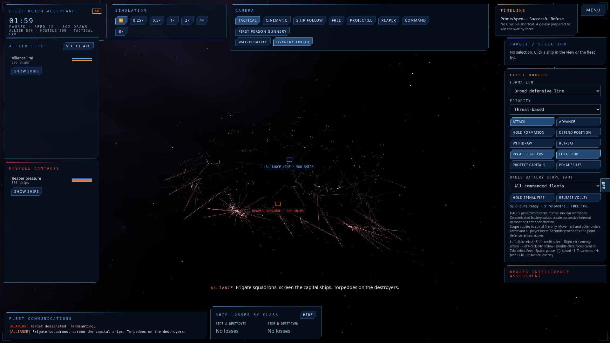
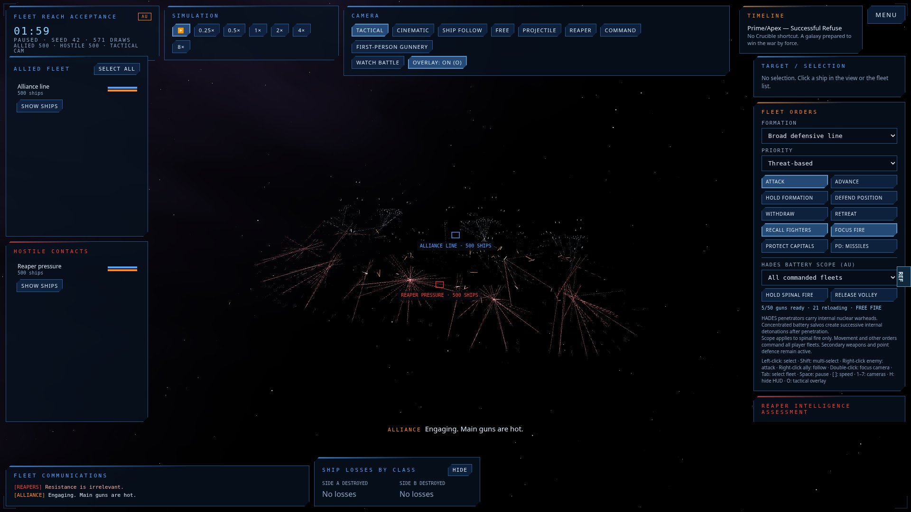

# Rear-rank engagement and class movement

Base: `b7c0b36` on `codex/apex-combat-overhaul`. Addresses cinematic acceptance #19 and the report of rear ranks watching the front fight.

## Reproduction and cause

Use `node --import tsx/esm scripts/engagement-coverage.ts 1000 42 180 harmless mixed`.
The roster is 50 Alliance dreadnoughts, 200 cruisers and 250 frigates versus 125 Reaper capitals and 375 destroyers, 90 nominal km apart, line abreast, Prime/Apex. Cohorts are fixed by deployment depth, before anyone moves. The harmless control sets damage to zero; movement, target selection, weapon range, arcs, heat and ammunition remain active.

At 180 simulated seconds on the base, 100% of the allied front third had fired, 76% of the middle third had fired, and **0/166 rear ships** had fired. No rear ship had an enemy within its principal weapon range. This was a station/reach failure, not an absence of enemies or a renderer-only defect.

The fleet anchor stops on one focus distance. Individual stations then have a short forward leash and a range trim capped at 15% of weapon range. Deep stations can remain permanently unreachable. Focus weighting and commitment can also retain a remote enemy while a local one is usable. Rear hulls beyond their own sensor query need the fleet's shared contact report to approach the engagement.

Lateral acceleration limits alone do not impose lateral speed limits: sustained RCS thrust eventually gives a capital its full main-engine speed sideways or backwards. The near-station/full-clearance thrust exception makes that conspicuous.

## Implementation

- Collect the nearest non-fighter contact during the existing scoring scan. Retain a selected contact already in range; repair an unreachable selection with a local contact. Explicit ship targets, fleet Attack Target orders, fighter interception and the capital/screen split during an enemy retreat retain their policies.
- Project an unreachable firing station inside the existing weapon envelope. Keep useful stations. This changes the waypoint, not the ship position, weapon range, firing arc or damage. Clearance and acceleration still decide how the ship arrives.
- Preserve the anti-chase leash for withdrawing contacts, with explicit attack/intercept commands retaining their intent.
- Add class-dependent lateral/reverse cruise envelopes relative to catalogue forward speed. Brake towards a reduced limit within available acceleration, including when the bow turns. Disabled engines conserve momentum.
- Outside gun range, face a distant navigation station and use the main drive. Near contact or while settling, return to gun bearing. Warhammer broadside handling stays separate.

There is no save-format change, extra combat RNG draw, range multiplier, scripted shot or forced winner. AU propulsion upgrades continue to scale catalogue speed/acceleration. Existing formation assignment is untouched.

## Lore and game references

These are the game's codex text, transcribed on a third-party host:

- [Space Combat](https://masseffectdb.wiki/mass-effect-3/codex/secondary/ships-and-vehicles/space-combat): dreadnought artillery from the rear; cruisers enter useful range later; frigates and fighters perform close attacks. Bow-on lateral evasion is part of the doctrine, so the fix permits RCS movement.
- [Frigates](https://masseffectdb.wiki/mass-effect/codex/secondary/ships-and-vehicles/starships-frigates): light mass, proportionally strong thrusters and wolfpack attacks support much greater vector agility than a capital.
- [Reaper Capabilities](https://masseffectdb.wiki/mass-effect-3/codex/secondary/the-reapers/reaper-capabilities) and [Vulnerabilities](https://masseffectdb.wiki/mass-effect-3/codex/secondary/the-reapers/reaper-vulnerabilities): superior propulsion and effective gunnery range; rapid capital turning requires reduced mass unsuitable for combat. FTL travel figures do not define a tactical throttle.
- [Official ME3 launch trailer](https://www.youtube.com/watch?v=bG2mdZ23eP8) and [original ME3 Sword fleet cutscene capture](https://www.youtube.com/watch?v=tLlAObjR-gs), sampled around 2:20–2:30 in the latter, provide visual references for bow alignment, capital scale and fleet framing. Edited camera cuts do not establish exact km/s.

Every numeric speed/envelope here is a simulation estimate. The sources establish roles and relative handling, not a canonical class-wide speed table.

| Role | Existing forward limit, simulation km/s (representative hull) | Lateral fraction | Reverse fraction |
| --- | ---: | ---: | ---: |
| Dreadnought | 0.26 | 0.25 | 0.18 |
| Cruiser | 0.36 | 0.42 | 0.30 |
| Frigate | 0.56 | 0.75 | 0.55 |
| Fighter | 1.56 | 0.95 | 0.85 |
| Carrier | 0.24 | 0.22 | 0.16 |
| Reaper capital | 0.32 | 0.20 | 0.15 |
| Reaper destroyer | 0.64 | 0.48 | 0.32 |

Forward limits, acceleration and turn-rate catalogue values are unchanged. The simultaneous forward/lateral velocity envelope is elliptical; fractions are not additive thrust allowances.

## Verification

- Full unit suite: **360/360 pass**, including unchanged canon and Prime/Apex reference outcomes, same-seed replay, inertial engine failure, damaged-capital settling, broadside handling, retreat interception and formation width.
- Typecheck and production build pass.
- Identical Chromium/SwiftShader 1,000-ship browser fixture at 120 simulated seconds: base fails rear-battery participation at **0%**; candidate passes the >75% rear-battery threshold, >80% width retention, finite positions, WebGL error and page-error checks. Tactical and rear-capital follow captures were inspected.
- Headless 1,000-ship harmless controls, seeds 7 and 42: **166/166 allied rear ships fire main batteries by 180 seconds**. Seed 42 retains 94.6% of initial allied width; seed 7 retains 95.4%.
- Natural-loss runs cover 1,000 and 2,000 ships; their measured reports accompany the PR. Attrition can kill front ships before they fire, so natural participation is reported against the original deployment cohort.

Measured main-battery participation, against each original rear third:

| Ships / seed / configuration | Simulated duration | Cloud wall time | Allied rear | Reaper rear |
| --- | ---: | ---: | ---: | ---: |
| Base 1,000 / 42 / harmless mixed line | 180 s | 135.948 s | 0/166 (any weapon) | Main battery not separated |
| Candidate 1,000 / 42 / harmless mixed line | 180 s | 185.529 s | 166/166 | 166/166 |
| Candidate 1,000 / 1337 / natural mixed line | 180 s | 89.948 s | 165/166 | 123/166 |
| Candidate 2,000 / 42 / natural mixed line | 150 s | 260.661 s | 204/333 | 177/333 |
| Base 400 / 1337 / harmless capital wedge, open 3D | 150 s | 72.286 s | 0/66 | 0/66 |
| Candidate 400 / 1337 / harmless capital wedge, open 3D | 150 s | 49.832 s | 63/66 | 7/66 |

[Raw checkpoints, final counts and movement samples](qa/engagement-metrics.json) retain the measurements. Wall time includes overlapping jobs; these are not controlled CPU throughput comparisons. The capital-only 3D wedge remains a poor rear-Reaper engagement case and is explicitly not marked fixed.

The headless measurements are cloud CPU wall time. Browser images use software WebGL. Neither establishes RTX 5090 frame rate, 4K performance, or a sustained 20,000-ship combat result.

| Base, 120 s | Candidate, 120 s |
| --- | --- |
|  |  |

## Concurrent work and remaining limits

Public PR #25 names unpublished P1 branches `feat/combat-reach-targeting-mass-20261109` and `feat/fleet-composer-silhouette-20261109`. This change deliberately leaves formation composition, fleet-anchor redesign, Reaper slew, frigate wolfpacks, doctrine fields and scripted scenes to that programme. The two small adapters in `ai.ts` and one in `motion.ts` must be reconciled with its implementations before merging; do not stack two movement controllers or replace either entire file.

Very deep 2,000+ deployments still have long physical closing times. A reachable waypoint prevents permanent idling but does not place a rear ship instantly within range. The formation-depth work remains necessary. The new browser acceptance and metrics script should be retained when the implementations are combined.
