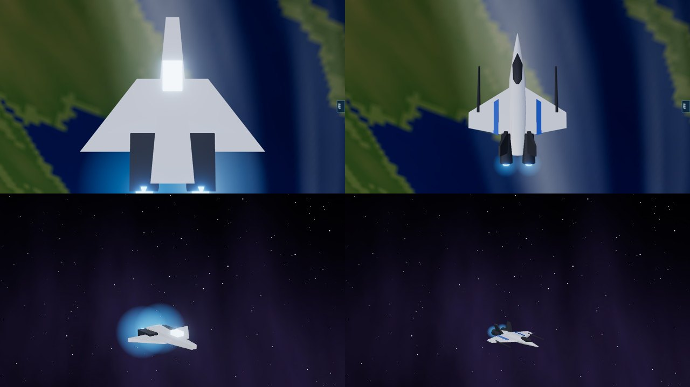
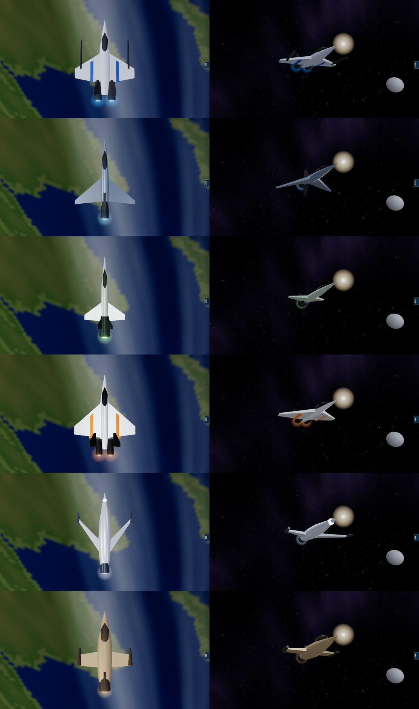

# Fighter models, 11 November 2026

Owner's report: fighters "draw too much visual attention compared to main weapons, looks messy like rat a tat gunfire or sparks ... want it improved or gone, and correct colour for actual organic fighters, improve ship, improve or rework low grade blocky designs".

The weapon-fire half of that report is `VISUAL_WEIGHT_2026-11-11.md`. This note is the craft themselves.

## What a fighter looked like

Rendered close (software renderer, fixed camera), an Alliance fighter was six boxes: a plank for a fuselage, one flat plate for both wings, two dark blocks, and a canopy drawn as a cube in the lit-window material. Each of its two engines carried a glow sprite 30 m across on a craft 36 m long, because the rule for glow size had a floor of 30 m meant for frigates. The Reaper Oculus, 16 m long, carried the same 30 m glow.

So in a battle a fighter was a white spark inside a blue ball, and its faction's hull colours never showed. The other five factions' fighters were built the same way.

Top row: the model from above, before and after. Bottom row: the same fighter in a dogfight, 220 m from the camera, before and after.

## What changed

- `src/rendering/ships/fighterKit.ts`: one kit builds every fighter from a specification: a pointed fuselage (a flattened body of revolution with four to eight sides), swept wing panels, a dark unlit canopy, engine nacelles with a small lit exhaust disc, fins, and optional gun booms or wing-tip pods. All geometry is generated in code; nothing is imported.
- Each faction's fighter is its own specification, next to that faction's other hulls:
  - Alliance: needle fuselage, cranked wings carrying two forward gun booms, twin drives under canted fins, blue wing stripes.
  - Turian: drooping, sharply swept blade wings, one drive, a fin above and below.
  - Salarian: a slender dart, short wings, a V tail around one large drive.
  - Cerberus: a faceted delta with a diamond-section fuselage, canted fins, orange stripes.
  - Geth: no canopy; a small sensor lens in a bulbous body between two forward-swept mandibles.
  - Quarian: a stubby hull, straight wings with tip pods, one oversized drive.
- `src/rendering/visualWeight.ts`, `engineGlowSize`: a fighter's engine glow is a fifth of its length and never under 5 m (Trident 7 m, Oculus 5 m). Other hulls keep the rule they had.

Each row is one faction (Alliance, turian, salarian, Cerberus, geth, quarian), from above and from the front quarter.

## Measured

| | Before | After |
|---|---|---|
| Triangles per fighter | 60 to 108 | 220 to 380 |
| Engine glow on a Trident (36 m) | 30 m at each engine | 7 m |
| Engine glow on an Oculus (16 m) | 30 m | 5 m |
| Lit canopy | a cube, every piloted fighter | none |

Fighters are drawn as models only within 9 km of the camera (27 km on the Ultra preset) and as points beyond, with their engine glows only within 3 km (9 km on Ultra). `tests/fighter-models.test.ts` (10 cases) holds the triangle budget, the stated length, outward-facing surfaces, engine attachment points, the unlit canopy, distinct silhouettes and the glow sizes. The simulation is untouched: fighter size, speed, weapons and counts are as they were.

## Not verified

- Frame rate on real hardware with many fighters close to the camera. The pictures here are from a software renderer.
- Whether the fighters are now too hard to see in a large battle. At 900 m a fighter is a few pixels and no longer carries a glow that marks it. If so, the remedy is the size of the distant-fighter mote, not the old glow.
- Which colour the owner meant. Nothing was recoloured: hull, stripe and engine colours are each faction's existing palette, now visible.

## Still open from the same report

Debris specks, and the remaining block hulls: the Alliance carrier first, then other factions' capitals.
