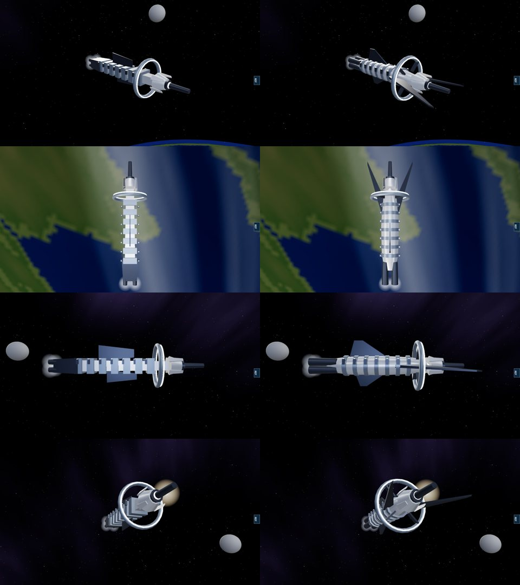
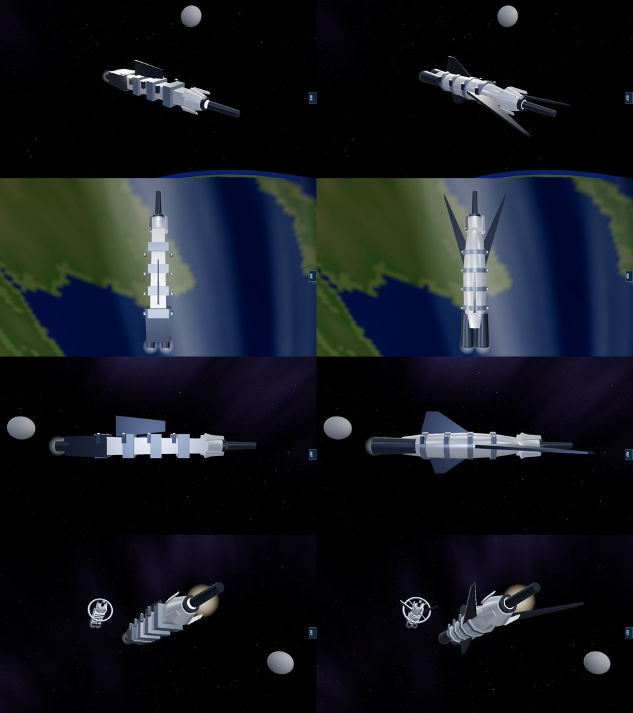
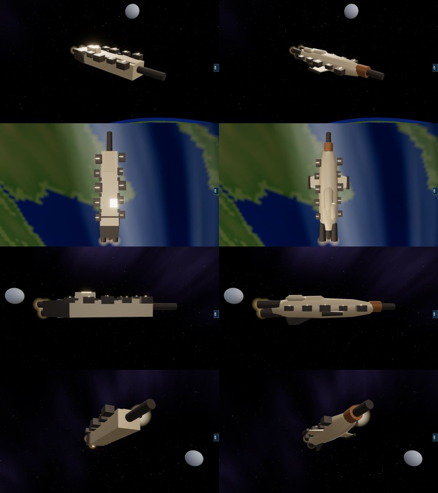

# Geth cruiser, geth dreadnought and quarian heavy cruiser — 12 November 2026

The owner was asked whether the last three hulls built from boxes should be redesigned and said yes. They had been left alone because, unlike the fighters, the carrier and the frigates, they were authored designs and the private reference pack has no frames of them.

Each keeps what made it its faction's and moves it onto a rounded hull. All geometry is generated in code, from the same kit as the fighters and frigates (`src/rendering/ships/fighterKit.ts`).

## Geth cruiser and dreadnought

Before: a tapered box under a chain of square plates, with the family's hooded head on the front, dark posts along the flanks and box fins. The dreadnought added a ring.

Now (`gethCapital` in `src/rendering/ships/geth.ts`): a rounded, segmented body with collars round it; the same head and single optic; the main gun running from the face of the head to the muzzle; forward-swept mandibles from the shoulders, as on the geth fighter and frigate; the lattice of lit struts along each flank; swept fins above and below; drives in nacelles at the old exhaust positions. The dreadnought keeps its forward ring, now tied to the hull by four spokes.

## Quarian heavy cruiser

Before: a tapered box with boxes on it and a cylinder out of the front.

Now: a fat, rounded cargo hull with the spinal gun run through it and out of the bow to the muzzle, clamped by a collar where it leaves, and its breech in a fairing on the back; the fleet's bolted-on modules down both flanks (the same ten); stub wings carrying sensor pods; a bridge blister off the centre line; a keel fin; three drives.

In every picture: left before, right after, same camera positions (quarter, from above, side, from below the bow). Software renderer.

## Measured

| | Geth cruiser | Geth dreadnought | Quarian heavy cruiser |
|---|---:|---:|---:|
| Triangles before | 676 | 1,828 | 720 |
| Triangles after | 944 | 2,312 | 928 |
| Pale hull triangles before / after | 108 / 216 | 108 / 240 | 36 / 216 |
| Length, muzzle, engine nodes | unchanged | unchanged | unchanged |

Nothing in the simulation reads the models. `tests/capital-hulls.test.ts` (5 cases) holds, for each hull: length, muzzle and engine nodes as measured on the old model; five merged meshes; outward-facing surfaces; the triangle count; a rounded body; the gun ending at the muzzle; and for the geth the head, optic, mandibles and ring, for the quarian the modules and wings.

## Not verified

- Likeness to the games' ships. There are no reference frames of these hulls; nothing was compared against one.
- How they read in motion and at fleet scale on real hardware.
- The quarian liveship and cruiser and the turian cruiser and dreadnought were not touched. They are angular, but none is a plain box.
