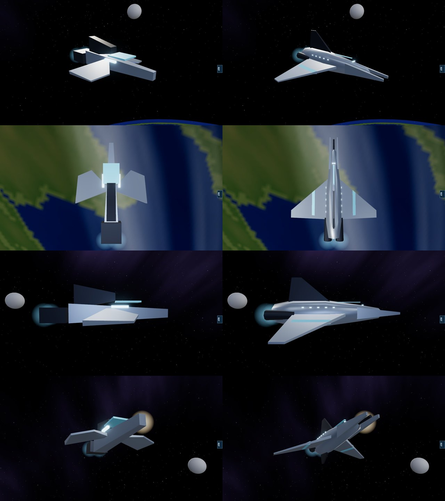

# Turian frigate, 11 November 2026

Owner's report: "improve or rework low grade blocky designs for better likeness".

After the fighters and the Alliance carrier, every other faction's capital hulls were rendered side by side to find the ones still made of boxes. The turian frigate stood out: it is the most numerous turian hull in a battle and was a tapered plank with two flat plates for wings, a wedge and a cube.

Left: before. Right: after. Same camera positions (quarter, from above, side, from below the bow). Software renderer.

## What it is now

A blade, in the turian language this project already uses (tall narrow hulls, pincer bows, swept wings, fins):

- a six-sided hull a quarter taller than wide, fullest abaft the middle;
- a split pincer bow, two blades either side of the spinal gun, out to the muzzle;
- broad wings swept hard back from the shoulder and angled down, with a cyan stripe;
- a tall swept fin above and a shorter one below;
- two drives in dark nacelles; a short row of lit ports each side.

It is built from the same kit as the fighters (`src/rendering/ships/fighterKit.ts`: `spindle`, `wingPanel`, `cornerSolid`, `mirrorX`, and `finPanel`, which is now exported). All geometry is generated in code.

There is no reference frame of a turian ship in the private pack, so this was not compared against one. The shape follows the trilogy's turian silhouette as generally known (a long pointed hull with broad swept wings); its details are this project's own.

## Measured

| | Before | After |
|---|---|---|
| Triangles | 160 | 464 |
| Nose of the model against the muzzle at 0.8 units | 0.10 short | at it |
| Length, muzzle, engine nodes | 1.6; (0, 0, 0.8); (±0.09, −0.02, −0.8) | the same |

Nothing in the simulation reads the model. `tests/turian-hulls.test.ts` (2 cases) holds the length, muzzle, engine nodes, outward-facing surfaces, triangle budget, the swept and drooped wings, the split bow and the fin.

## Not verified

- How it reads in motion and in numbers on real hardware.

## Still block models, in the order they stood out

Cerberus frigate; geth frigate, cruiser and dreadnought (chains of boxes); quarian heavy cruiser. The turian cruiser and dreadnought are angular but already have their pincer bows and fins. Asari and salarian hulls are already bodies of revolution.
